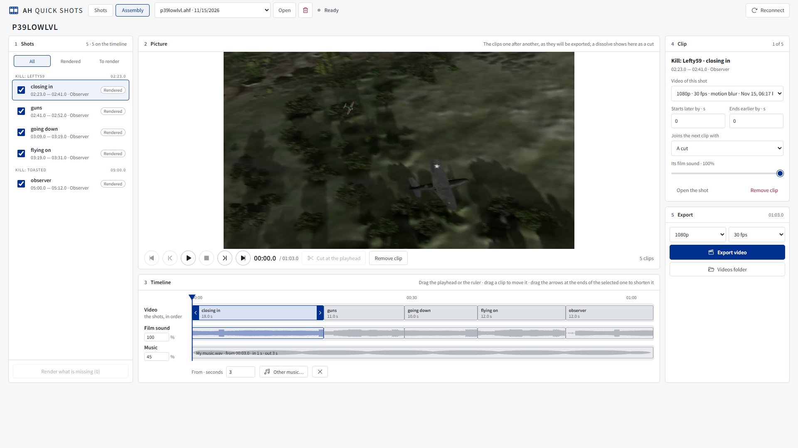

# AH Quick Shots

Pick the good moments of an Aces High III film, look at them through a dozen
cameras, and render the ones you like. AH Quick Shots is a page in your browser
that drives the offline Film Viewer for you: the viewer keeps the world, draws
the picture and renders the video with the film's sound.


A fight filmed with it, on YouTube:

[](https://www.youtube.com/watch?v=v4BFbKYKXig)

How the cameras follow a fight, drawn from a real one, in 100 seconds:
[how-it-works.mp4](https://ideanima.pl/ah-quick-shots/how-it-works.mp4). The
tool's page: [ideanima.pl/ah-quick-shots](https://ideanima.pl/ah-quick-shots/).

**Unofficial.** This tool is not made by, endorsed by or affiliated with
HiTech Creations. It uses only the Film Viewer's documented local socket (the
commands the viewer lists under `help`). It does not touch the game, and it
does not read the viewer's memory or its film files.

## What you need

- Windows
- Aces High III **Film Viewer 3.07 Patch 3 or newer** (the game updates itself when you start it)
- a current browser

That is all with the Windows package. Run from the source code instead, it
also needs **Python 3.11 or newer** on the PATH (no extra packages) and,
optionally, **ffmpeg** on the PATH: it makes the motion blur, the data
overlay and the Assembly's video. The package brings both.

## Start

1. Download **AH-Quick-Shots-Windows.zip** (about 50 MB) from the
   [latest release](https://github.com/fuftufajf/ah-quick-shots/releases/latest).
2. Unzip it to a place **without spaces in its path**, for example `C:\`:
   it makes the folder `C:\ah-quick-shots`.
3. Close the game and start Film Viewer.
4. Double-click **AH Quick Shots.bat** in that folder. The page opens and
   connects by itself.

Nothing is installed and nothing in Windows is changed; to remove it, delete
the folder. From the source code instead: Code > Download ZIP on this page,
unzip it to a folder without spaces in its path, and start the same file.

### Is the download safe?

The zip is built by GitHub itself from the public source code on this page,
every time a version is released, by the workflow you can read in
[.github/workflows/package.yml](.github/workflows/package.yml). Its SHA-256
checksum is published next to it on the release page, so you can check that
your download is exactly that build: in PowerShell,
`Get-FileHash AH-Quick-Shots-Windows.zip` must print the same number, in
capitals. GitHub
also signs a record that this workflow made the file; with the GitHub CLI,
`gh attestation verify AH-Quick-Shots-Windows.zip -R fuftufajf/ah-quick-shots`
checks it.

Inside are the official portable Python from python.org (signed by the Python
Software Foundation), the free ffmpeg video tool (gyan.dev's build of an FFmpeg
release), the font of the data overlay and this program's own small source
files. There is no installer, no Windows service and no account, and nothing
is sent anywhere: it talks only to Film Viewer on your own PC, through the
viewer's documented socket, and to your browser on 127.0.0.1. It does not use
AI.

Windows may ask once whether to run a file from the internet: that is because
the download is free and not paid-signed, not because anything is wrong. To
skip the question, right-click the zip > Properties > tick Unblock > OK before
unzipping.

## How to use it

**Replays.** Choose a replay (the ones you opened lately come first) and
press Open. Its name stands large at the top: type over it and press Enter to
rename the file. The bin deletes the chosen replay; the open one is only
marked, and goes to the Recycle Bin when you open the next.

**Shots**, the first view, top to bottom:

1. **Moments** — your fights, one row each. Click one and a shot is prepared
   around it; the green arrow adds it straight to the cut.
2. **Picture** — Play (Space) plays the shot in Film Viewer's own window,
   nothing rendered. Render and play makes a clip on the page. Set in and Set
   out (I, O) mark the shot at the playhead; drag its ends to trim. Drag the
   picture to move the camera, turn the wheel to zoom, Shift and the wheel to
   bring the camera nearer. The camera's values sit in the picture's corners:
   click one to set it exactly. Names shows the pilots' names, in renders too.
   9:16 dims all but the middle of the picture that a vertical reel keeps; the
   page remembers it.
3. **Cameras** — Lead and Opponent say whom the shot films; one click shows the
   shot through that camera; Rate cameras measures them all. Add to cut keeps
   the shot. Double-click a shot in The cut to rename it.
   - **Observer** flies along like a third aircraft. To direct it, set the
     picture, press Keyframe (K), move the playhead and set it again: it
     glides between the keyframes. Looks at (Both, You, Opponent) is kept in
     each keyframe, so it can turn from one aircraft to the other. Its own
     path pins each keyframe to the sky. Looking at You, Rides your aircraft
     fastens the camera to your aircraft: for a stretch where your aircraft
     hops in the picture (Film Viewer draws it so after you are shot down).
   - **Tripod** stands still and follows by turning and zooming only.
   - The rest: you or the opponent in front, close views, over your shoulder,
     from your wing, behind you, fly-bys, the cockpit (straight ahead, or as
     you looked in the fight), cameras on the airframe, riding the bomb.
4. **The cut** — tick the shots to render, choose 1080p, 4K or a quick
   draft, 30 or 60 frames a second, one video or a file per shot, then Render
   selected. Motion blur (kept with each shot) takes about four times as long
   and looks like film. Data overlay adds, beside each video, a transparent
   film of your speed, height, climb and G and the range to your opponent, to
   lay over it in an editor (16:9 and 9:16). Add my kills makes four shots for every kill; Take-offs
   & landings finds yours. Videos folder opens the finished videos. Shots
   stand in film order, each with when it was made and last changed; a copy
   added to the cut is named by its camera. A shot rendered before asks whether
   the new video goes beside the old one or overwrites it.

**Assembly**, the second view: your rendered shots in a row on a timeline.
Drag a clip to move it, drag its ends to trim, cut it at the playhead (S),
join two with a cut or a dissolve, set each clip's sound and add music of your
own. Export video makes one film of it.



| Key | Shots | Assembly |
| --- | --- | --- |
| Space | play or pause | play or pause |
| I, O | shot starts, ends at the playhead | |
| K, Delete | set or remove a keyframe | |
| [ and ] | previous, next keyframe | |
| Home | to the shot's start | to the start (End: to the end) |
| Up, Down | | previous, next cut |
| S | | cut the clip at the playhead |

Finished videos are in **Videos\AH Quick Shots**, each named after its film,
time, shot and camera.

**Still being made.** A film look with haze and wingtip trails are offered only when AH Quick Shots is run from the source code, not
by the Windows package: they are experimental.

## Known limits

- **Film Viewer does not run beside the game.** If the viewer exits at once,
  close the game and start the viewer again.
- **Cancel stops a render after the pass Film Viewer is rendering.** The
  socket cannot stop the viewer's own render, so Cancel (on the wait over the
  picture) stops ffmpeg at once and begins nothing more; to stop the viewer at
  once, stop it in Film Viewer's window. Videos finished before are kept.
  Playing can be stopped: Pause and Stop hold the clip on the page and what
  plays in Film Viewer's own window alike.
- **A render may wait for the sound of the one before.** Started too soon, the
  viewer loses the engine, guns and voices, so the desk waits (the status line
  says for how long).
- **30 frames a second are rendered at 60.** Asked for 30, Film Viewer draws your own aircraft a frame out of
  place now and then, and it hops in the picture; at 60 it does not. So the desk renders a 30 fps video at
  60 and keeps every second frame: the render takes longer than it used to.
- **Motion blur and a propeller that turns slowly.** The blur blends four
  moments of each frame. A running propeller is a disc and blurs well; one
  that windmills on a dead engine shows as four faint copies of each blade.
- **Trails and gun cam** are not in the socket: tick them in the viewer's Edit
  tools.
- **Paths with spaces.** The viewer takes no spaces in a video path. It
  renders into a working folder without spaces and the desk copies the
  finished video to your Videos folder; keep the app's own folder free of
  spaces too.
- **Deleting goes through the Recycle Bin.** A replay or a video on a drive
  that has none (a network share, a USB stick) is left where it is, and the
  page says so: delete it in its folder yourself.
- **Reporting a problem.** The page shows its version beside its name, and
  `.quickshots/errors.log` in the app's folder holds each operation that
  failed. Send both.
- The server has no window. It runs until you sign out of Windows or end
  `pythonw.exe` in Task Manager. Starting AH Quick Shots from another folder
  stops the one left running (unless it is rendering), so the page is always
  the copy you started. Version 0.2.0 and older did not: the page came from the
  old copy, blank or "404 Not Found". Then end `pythonw.exe` in Task Manager
  once, or restart Windows, and start the new copy again.
- **Updating.** A new version unzipped over a running desk is not used until
  the desk restarts: the page says so and has a Restart the desk button.
  Version 0.1.5 and older cannot tell, so end `pythonw.exe` in Task Manager once.
  The package's own Python cannot be replaced while it runs: end `pythonw.exe`
  in Task Manager first, then unzip the new package over the old folder. Your
  saved shots stay either way.
- Camera ratings see the ground and buildings as Film Viewer models them (a building as a box), not trees: watch the shot before you render it.

## How it is built


- `viewer_socket.py` — the viewer's text protocol
- `shot_plan.py` — shot geometry and the viewer's camera commands
- `flight_data.py` — speed, height, G, energy and the geometry between two aircraft, from the viewer's kept tracks
- `overlay.py` — the data overlay: a transparent ProRes film of those numbers to lay over a render in an editor
- `director_core.py` — saved plans, revision checks, the one worker that owns the viewer
- `director_api.py` — loopback-only HTTP, same-origin gate, media serving
- `ui/src/` — the page; `ui/dist/` is its ready build, so Node is not needed to run
- `fonts/` — Source Sans Pro, the data overlay's font
- `dev/try_camera.py` — renders unsaved cameras through the running desk, for judging camera work
- `dev/build_package.py` — builds the Windows package; GitHub runs it when a version is released

Everything stays on your computer: the server listens on 127.0.0.1 only. Your
shots are saved under `.quickshots/` beside the code.

[How it works](docs/how-it-works.md) has the details: every camera, the files,
the HTTP API, and what was measured in the viewer.

## Development

```
python director_api.py --check
node ui/src/desk.test.mjs
npm --prefix ui ci
npm --prefix ui run build
```

None of the checks needs Film Viewer. `python dev/build_package.py` builds
the Windows package into `build/`, as GitHub does for a release.

## Thanks

Thanks to Steely: Quick Shots frames its shots by the director guide he
trained, which HiTech ships in the Film Viewer's help; it uses his kill-sequence
recipe, and used his fix for see-through aircraft until Film Viewer 3.07 Patch 3
did it itself. See his
[Aces High film companion](https://github.com/steelington/aces-high-film-companion).

## Licence

[MIT](LICENSE). The page's build includes React and Phosphor Icons, and is
made with Vite; all three are MIT too. The overlay's font, Source Sans Pro, is
under the SIL Open Font License. The Windows package also holds Python (PSF
License) and ffmpeg (GPL v3), each with its licence beside it. See
[THIRD-PARTY-NOTICES.md](THIRD-PARTY-NOTICES.md).

Aces High is a trademark of HiTech Creations, Inc.
