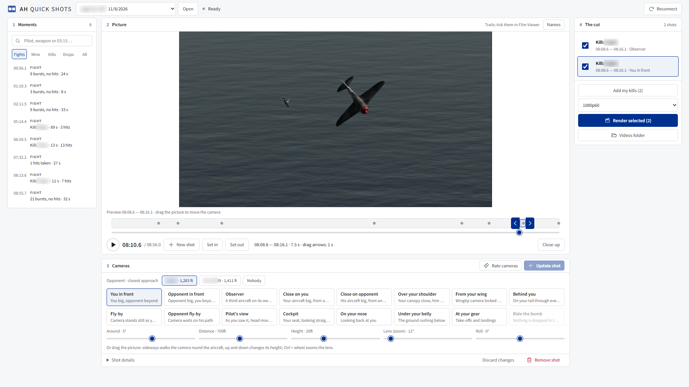

# AH Quick Shots

Pick the good moments of an Aces High III film, look at them through a dozen
cameras, and render the ones you like. AH Quick Shots is a page in your browser
that drives the offline Film Viewer for you: the viewer keeps the world, draws
the picture and renders the video with the film's sound.



A fight filmed with it, on YouTube:

[](https://www.youtube.com/watch?v=v4BFbKYKXig)

**Unofficial.** This tool is not made by, endorsed by or affiliated with
HiTech Creations. It uses only the Film Viewer's documented local socket (the
commands the viewer lists under `help`). It does not touch the game, and it
does not read the viewer's memory or its film files.

## What you need

- Windows
- Aces High III **Film Viewer 3.07 Patch 2 or newer**
- a current browser

That is all with the Windows package. Run from the source code instead, it
also needs **Python 3.11 or newer** on the PATH (no extra packages) and,
optionally, **ffmpeg** on the PATH: with it a video is rendered from two
seconds early and those seconds are cut off, so the other aircraft are solid
from the first frame (without it they can fade in during the first second),
and it draws the data overlay (below). The package brings both.

## Start

1. Download **AH-Quick-Shots-Windows.zip** (about 50 MB) from the
   [latest release](https://github.com/fuftufajf/ah-quick-shots/releases/latest).
2. Unzip it to a place **without spaces in its path**, for example `C:\`:
   it makes the folder `C:\ah-quick-shots`.
3. Close the game and start Film Viewer.
4. Double-click **AH Quick Shots.bat** in that folder. The page opens and
   connects by itself.

Nothing is installed and nothing in Windows is changed; to remove it, delete
the folder. From the source code instead: Code > Download ZIP on this page,
unzip it to a folder without spaces in its path, and start the same file.

### Is the download safe?

The zip is built by GitHub itself from the public source code on this page,
every time a version is released, by the workflow you can read in
[.github/workflows/package.yml](.github/workflows/package.yml). Its SHA-256
checksum is published next to it on the release page, so you can check that
your download is exactly that build: in PowerShell,
`Get-FileHash AH-Quick-Shots-Windows.zip` must print the same number, in
capitals. GitHub
also signs a record that this workflow made the file; with the GitHub CLI,
`gh attestation verify AH-Quick-Shots-Windows.zip -R fuftufajf/ah-quick-shots`
checks it.

Inside are the official portable Python from python.org (signed by the Python
Software Foundation), the free ffmpeg video tool (gyan.dev's build of an FFmpeg
release), the font of the data overlay and this program's own small source
files. There is no installer, no Windows service and no account, and nothing
is sent anywhere: it talks only to Film Viewer on your own PC, through the
viewer's documented socket, and to your browser on 127.0.0.1. It does not use
AI.

Windows may ask once whether to run a file from the internet: that is because
the download is free and not paid-signed, not because anything is wrong. To
skip the question, right-click the zip > Properties > tick Unblock > OK before
unzipping.

## Work down the page

1. **Moments** — open a film (newest first). "Fights" lists your engagements,
   one row each, with the opponent you actually fought. Click one: a shot is
   prepared around it.
2. **Picture** — Play (Space) renders a short preview clip with sound, once;
   after that it replays and scrubs from its file. Set in / Set out (I / O)
   mark the shot at the playhead; drag the ends of the highlighted range to
   trim it. Drag the picture to walk the camera round the aircraft, or to
   turn a camera on the airframe; the wheel over the picture zooms. In Film
   Viewer plays it at once in the viewer's own window (keep it on screen),
   nothing rendered. With a
   shot of a kill, take-off or landing selected, Play shows all its shots in
   a row, as the cut will render them; clicking the shot in the cut plays it
   alone.
3. **Cameras** — one click shows the moment through that camera, before
   anything is saved: you or the opponent in front, an observer flying along
   like a third aircraft, close views, over your shoulder, from your wing,
   behind you, a fly-by, the pilot's own view, cameras on the airframe, riding
   the bomb. Sliders or a drag adjust it (a lift-off or roll-out also has
   Swing round and Ends at). Add to cut keeps the shot.
4. **The cut** — the green arrow beside a moment adds it straight to the cut
   (a kill as four shots); the x beside a shot, or Clear, takes shots out, and
   asks whether their videos go to the Recycle Bin too. Tick the shots you
   want and Render selected: 1080p60, 4K or a
   quick draft, as one video with the gaps between shots left out or as a file
   per shot for cutting in an editor. Tick Data overlay to get, beside each
   video, a transparent film of your speed, height, climb and G and the range
   to your opponent, to lay over it in DaVinci Resolve or another editor: one
   for a 16:9 timeline, one for a 9:16 reel. Tick Motion blur for the streak
   a film camera leaves on fast motion; the render takes about four times as
   long. Film look (a film camera's colour, glow, vignette and grain, fitted to
   a DaVinci Resolve grade of this footage), Haze (mist along the horizon) and
   Trails (two smooth lines from the wingtips of the shot's aircraft, yours and
   your opponent's in colours you pick; short ones follow the aircraft, lasting
   ones leave the fight's ribbons in the sky for a wide shot afterwards) are
   experimental and still being tuned. Beside each of these the page says
   what it adds to the render's time, and above Render selected the whole of
   it: estimates, corrected to your PC after each render. Add my kills makes four
   shots for every kill of yours: you closing in, your guns, him going down,
   you flying on. Take-offs & landings finds yours in your flight path and adds
   a few shots for each: the roll, the wheels, the lift-off with the camera
   swinging round you, the climb; the approach, the touchdown, the roll-out.
5. **Assembly** (the second view, beside Shots) — every shot rendered as a
   file of its own lines up on a timeline, in film order, by itself. Drag a
   clip to move it, drag the ends of the selected one to trim it, cut it at
   the playhead (S), join two with a cut or a short dissolve, set each clip's
   sound, and add one piece of music of your own under the film's sound.
   A shot whose camera you changed since is marked Changed; Render what is
   missing renders those and the ones with no video yet. Export video makes
   one video of the timeline with ffmpeg, while the desk goes on. The music
   is yours to choose and to have the right to use: none comes with the app.

Finished videos are in **Videos\AH Quick Shots**, each named after its film,
time, shot and camera; Videos folder, under The cut, opens it.

## Known limits

- **Film Viewer does not run beside the game.** If the viewer exits at once,
  close the game and start the viewer again.
- **A render cannot be interrupted** from the page. Stop it in Film Viewer if
  you must.
- **A render may wait for the sound of the one before.** Started too soon, the
  viewer loses the engine, guns and voices, so the desk waits (the status line
  says for how long).
- **Trails and gun cam** are not in the socket: tick them in the viewer's Edit
  tools.
- **Paths with spaces.** The viewer takes no spaces in a video path. It
  renders into a working folder without spaces and the desk copies the
  finished video to your Videos folder; keep the app's own folder free of
  spaces too.
- **Deleting goes through the Recycle Bin.** A replay or a video on a drive
  that has none (a network share, a USB stick) is left where it is, and the
  page says so: delete it in its folder yourself.
- **Reporting a problem.** The page shows its version beside its name, and
  `.quickshots/errors.log` in the app's folder holds each operation that
  failed. Send both.
- The server has no window. It runs until you sign out of Windows or end
  `pythonw.exe` in Task Manager. Starting AH Quick Shots from another folder
  stops the one left running (unless it is rendering), so the page is always
  the copy you started. Version 0.2.0 and older did not: the page came from the
  old copy, blank or "404 Not Found". Then end `pythonw.exe` in Task Manager
  once, or restart Windows, and start the new copy again.
- **Updating.** A new version unzipped over a running desk is not used until
  the desk restarts: the page says so and has a Restart the desk button.
  Version 0.1.5 and older cannot tell, so end `pythonw.exe` in Task Manager once.
  The package's own Python cannot be replaced while it runs: end `pythonw.exe`
  in Task Manager first, then unzip the new package over the old folder. Your
  saved shots stay either way.
- Camera ratings know nothing of terrain: watch the shot before you render it.

## How it is built


- `viewer_socket.py` — the viewer's text protocol
- `shot_plan.py` — shot geometry and the viewer's camera commands
- `flight_data.py` — speed, height, G, energy and the geometry between two aircraft, from the viewer's kept tracks
- `overlay.py` — the data overlay: a transparent ProRes film of those numbers to lay over a render in an editor
- `director_core.py` — saved plans, revision checks, the one worker that owns the viewer
- `director_api.py` — loopback-only HTTP, same-origin gate, media serving
- `ui/src/` — the page; `ui/dist/` is its ready build, so Node is not needed to run
- `fonts/` — Source Sans Pro, the data overlay's font
- `dev/try_camera.py` — renders unsaved cameras through the running desk, for judging camera work
- `dev/build_package.py` — builds the Windows package; GitHub runs it when a version is released

Everything stays on your computer: the server listens on 127.0.0.1 only. Your
shots are saved under `.quickshots/` beside the code.

[How it works](docs/how-it-works.md) has the details: every camera, the files,
the HTTP API, and what was measured in the viewer.

## Development

```
python director_api.py --check
node ui/src/desk.test.mjs
npm --prefix ui ci
npm --prefix ui run build
```

None of the checks needs Film Viewer. `python dev/build_package.py` builds
the Windows package into `build/`, as GitHub does for a release.

## Licence

[MIT](LICENSE). The page's build includes React and Phosphor Icons, and is
made with Vite; all three are MIT too. The overlay's font, Source Sans Pro, is
under the SIL Open Font License. The Windows package also holds Python (PSF
License) and ffmpeg (GPL v3), each with its licence beside it. See
[THIRD-PARTY-NOTICES.md](THIRD-PARTY-NOTICES.md).

Aces High is a trademark of HiTech Creations, Inc.
