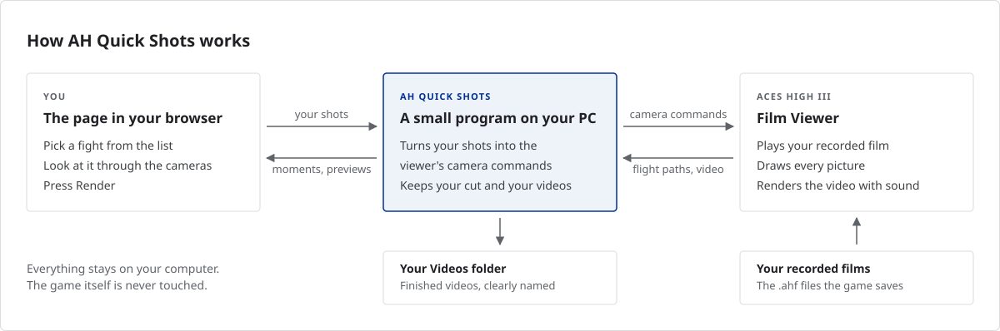

# AH Quick Shots

Pick the good moments of an Aces High III film, look at them through a dozen
cameras, and render the ones you like. AH Quick Shots is a page in your browser
that drives the offline Film Viewer for you: the viewer keeps the world, draws
the picture and renders the video with the film's sound.


A fight filmed with it, on YouTube:

[](https://www.youtube.com/watch?v=v4BFbKYKXig)

**Unofficial.** This tool is not made by, endorsed by or affiliated with
HiTech Creations. It uses only the Film Viewer's documented local socket (the
commands the viewer lists under `help`). It does not touch the game, and it
does not read the viewer's memory or its film files.

## What you need

- Windows
- Aces High III **Film Viewer 3.07 Patch 2 or newer**
- **Python 3.11 or newer**, on the PATH (no extra packages)
- optional: **ffmpeg** on the PATH. With it a video is rendered from two
  seconds early and those seconds are cut off, so the other aircraft are solid
  from the first frame; without it they can fade in during the first second.
- a current browser

## Start

1. Download this repository and unzip it to a folder **without spaces in its
   path**, for example `C:\ah-quick-shots`.
2. Close the game and start Film Viewer.
3. Double-click **AH Quick Shots.bat**. The page opens and connects by itself.

## Work down the page

1. **Moments** — open a film (newest first). "Fights" lists your engagements,
   one row each, with the opponent you actually fought. Click one: a shot is
   prepared around it.
2. **Picture** — Play (Space) renders a short preview clip with sound, once;
   after that it replays and scrubs from its file. Set in / Set out (I / O)
   mark the shot at the playhead; drag the ends of the highlighted range to
   trim it. Drag the picture to walk the camera round the aircraft, or to
   turn a camera on the airframe; the wheel over the picture zooms. In Film
   Viewer plays it at once in the viewer's own window, nothing rendered. With a
   shot of a kill, take-off or landing selected, Play shows all its shots in
   a row, as the cut will render them; clicking the shot in the cut plays it
   alone.
3. **Cameras** — one click shows the moment through that camera, before
   anything is saved: you or the opponent in front, an observer flying along
   like a third aircraft, close views, over your shoulder, from your wing,
   behind you, a fly-by, the pilot's own view, cameras on the airframe, riding
   the bomb. Sliders or a drag adjust it (a lift-off or roll-out also has
   Swing round and Ends at). Add to cut keeps the shot.
4. **The cut** — tick the shots you want and Render selected: 1080p60, 4K or a
   quick draft, with the gaps between shots left out. Add my kills makes four
   shots for every kill of yours: you closing in, your guns, him going down,
   you flying on. Take-offs & landings finds yours in your flight path and adds
   a few shots for each: the roll, the wheels, the lift-off with the camera
   swinging round you, the climb; the approach, the touchdown, the roll-out.

Finished videos are in **Videos\AH Quick Shots**, each named after its film,
time, shot and camera; Videos folder, under The cut, opens it.

## Known limits

- **Film Viewer does not run beside the game.** If the viewer exits at once,
  close the game and start the viewer again.
- **A render cannot be interrupted** from the page. Stop it in Film Viewer if
  you must.
- **A render may wait for the sound of the one before.** Started too soon, the
  viewer loses the engine, guns and voices, so the desk waits (the status line
  says for how long).
- **Trails and gun cam** are not in the socket: tick them in the viewer's Edit
  tools.
- **Paths with spaces.** The viewer takes no spaces in a video path. It
  renders into a working folder without spaces and the desk copies the
  finished video to your Videos folder; keep the app's own folder free of
  spaces too.
- The server has no window. It runs until you sign out of Windows or end
  `pythonw.exe` in Task Manager.
- **Updating.** A new version unzipped over a running desk is not used until
  the desk restarts: the page says so and has a Restart the desk button.
  Version 0.1.5 and older cannot tell, so end `pythonw.exe` in Task Manager once.
- Camera ratings know nothing of terrain: watch the shot before you render it.

## How it is built



- `viewer_socket.py` — the viewer's text protocol
- `shot_plan.py` — shot geometry and the viewer's camera commands
- `director_core.py` — saved plans, revision checks, the one worker that owns the viewer
- `director_api.py` — loopback-only HTTP, same-origin gate, media serving
- `ui/src/` — the page; `ui/dist/` is its ready build, so Node is not needed to run
- `dev/try_camera.py` — renders unsaved cameras through the running desk, for judging camera work

Everything stays on your computer: the server listens on 127.0.0.1 only. Your
shots are saved under `.quickshots/` beside the code.

[How it works](docs/how-it-works.md) has the details: every camera, the files,
the HTTP API, and what was measured in the viewer.

## Development

```
python director_api.py --check
node ui/src/desk.test.mjs
npm --prefix ui ci
npm --prefix ui run build
```

None of the checks needs Film Viewer.

## Licence

[MIT](LICENSE). The page's build includes React and Phosphor Icons, and is
made with Vite; all three are MIT too, see
[THIRD-PARTY-NOTICES.md](THIRD-PARTY-NOTICES.md).

Aces High is a trademark of HiTech Creations, Inc.
